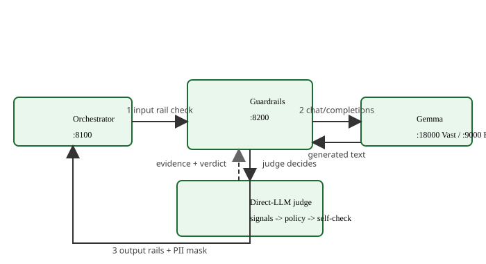
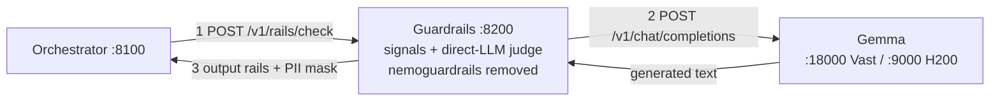
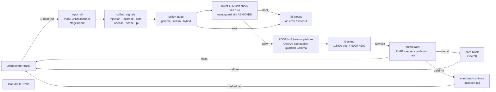
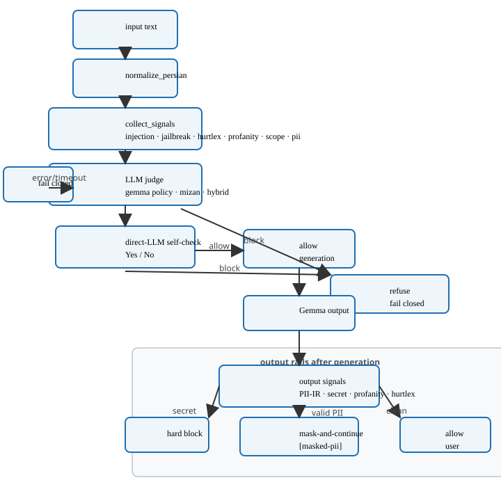
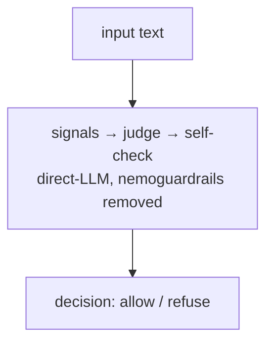
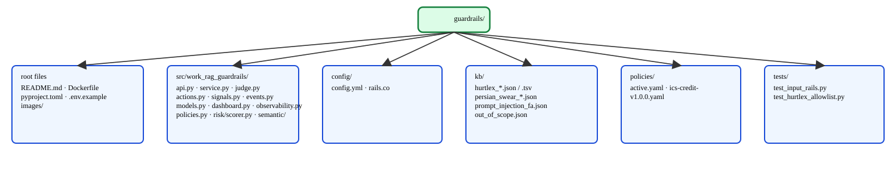
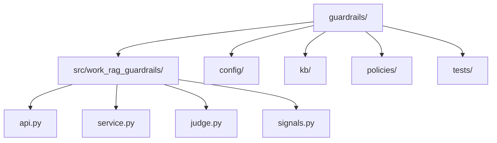

# Work RAG Guardrails

Persian-aware safety policy boundary and **guarded Gemma gateway** for the Work Credit RAG platform.

**Status:** implemented and live on Vast.ai (`vast-gemma4-migration`). Deterministic Persian rails + risk scoring + semantic interface.

`nemoguardrails` has been removed. The service now runs **deterministic signals + a direct-LLM judge** (one-LLM Yes/No self-check) with fail-closed behavior. No NeMo / Colang flow is executed at runtime.

## 1. Summary

Guardrails owns **policy enforcement** around the self-hosted Gemma generation service. In the MVP request path it:

- Runs deterministic input/output checks before retrieval and generation
- Emits **evidence signals** (injection, jailbreak, HurtLex hate, profanity, scope, PII) that the LLM judge weighs — detectors do not block directly, except `secret`
- Runs a **direct-LLM judge self-check** (one LLM Yes/No call) as a second opinion
- Serves an **OpenAI-compatible guarded Gemma gateway** (`POST /v1/chat/completions`)
- Returns structured decisions and stable refusal responses
- Exposes health/readiness endpoints and a Persian dashboard on `:8200`

**Design goal:** fail closed — if the policy engine errors or times out, the request is refused rather than passed through.

### Caption: Guardrails position in the platform — high-level black box



<details>
<summary>Diagram source (Mermaid)</summary>


</details>

### Caption: Guardrails position in the platform — detailed technical


<details>
<summary>Diagram source (Mermaid)</summary>


</details>

### Caption: Internal pipeline (adjudicate) — high-level black box



<details>
<summary>Diagram source (Mermaid)</summary>


</details>

### Caption: Internal pipeline (adjudicate) — detailed technical


<details>
<summary>Diagram source (Mermaid)</summary>

```mermaid
flowchart TD
    IN[input text] --> NORM[normalize_persian]
    NORM --> SIG[collect_signals\ninjection · jailbreak · hurtlex\n· profanity · scope · pii]
    SIG --> DOMAIN[needs_domain_check\nout_of_domain signal]
    DOMAIN --> JUDGE[policy judge\ngemma · mizan · hybrid]
    JUDGE --> SELF[direct-LLM self-check\nYes / No\nfail closed on error]
    SELF -->|allow| ALLOW[allow → generation]
    SELF -->|block| REF[refuse]
    JUDGE -->|block| REF
    subgraph OUTRAILS[output rails after generation]
    GEN[Gemma output] --> OSIG[output signals\nPII-IR · secret · profanity · hate]
    OSIG -->|secret| HB[hard block]
    OSIG -->|valid PII| MASK[mask-and-continue [masked-pii]]
    OSIG -->|clean| OUT[allow → user]
    end
```
</details>

### Caption: Code hierarchy — high-level black box



<details>
<summary>Diagram source (Mermaid)</summary>


</details>

### Caption: Code hierarchy — detailed technical

```mermaid
graph TD
    ROOT[guardrails/]
    ROOT --> README[README.md]
    ROOT --> DOCKER[Dockerfile]
    ROOT --> PYPROJ[pyproject.toml]
    ROOT --> ENV[.env.example]
    ROOT --> IMG[images/]
    ROOT --> SRC[src/work_rag_guardrails/]
    SRC --> API[api.py]
    SRC --> SVC[service.py]
    SRC --> JUDGE[judge.py]
    SRC --> ACTIONS[actions.py]
    SRC --> SIGNALS[signals.py]
    SRC --> EVENTS[events.py]
    SRC --> MODELS[models.py]
    SRC --> DASH[dashboard.py]
    SRC --> OBS[observability.py]
    SRC --> POLICIES[policies.py]
    SRC --> RISK[risk/scorer.py]
    SRC --> SEM[semantic/]
    SEM --> HATE[hate.py]
    SEM --> TOX[toxicity.py]
    SEM --> INTENT[intent.py]
    ROOT --> CFG[config/]
    CFG --> YML[config.yml]
    CFG --> CO[rails.co]
    ROOT --> KB[kb/]
    KB --> HURTLEX[hurtlex_*.json/tsv]
    KB --> PERSIAN[persian_swear_*.json]
    KB --> INJECTION[prompt_injection_fa.json]
    KB --> SCOPE[out_of_scope.json]
    ROOT --> POL[policies/]
    POL --> ACTIVE[active.yaml]
    POL --> ICS[ics-credit-v1.0.0.yaml]
    ROOT --> TESTS[tests/]
```


<details>
<summary>Diagram source (Mermaid)</summary>


</details>

## 2. How a request is guarded

MVP path (Vast.ai):

1. Orchestrator `:8100` asks Guardrails `:8200` for an **input rail check** (`POST /v1/rails/check`, `stage=input`) before touching the KB.
2. Guardrails runs deterministic signals, then the LLM judge, then the direct-LLM self-check. On any block it returns a premade refusal (`finish_reason="content_filter"`).
3. If allowed, the orchestrator retrieves from KB `:8000` and sends its built prompt to Guardrails' **guarded chat endpoint** (`POST /v1/chat/completions`).
4. Guardrails calls upstream Gemma directly (`:18000` Vast / `:9000` H200 manager), runs **output rails** on the generated text, applies PII mask-and-continue or hard block, and returns the OpenAI-compatible response.

Guardrails does not own retrieval, conversation orchestration, the frontend, or model serving. Only Guardrails calls the Gemma manager in the MVP path.

## 3. API contract

| Method | Path | Purpose |
|--------|------|---------|
| `GET` | `/health` | Process liveness: `{"status":"ok"}` |
| `GET` | `/ready` | Re-checks upstream Gemma; returns `{status, nemo_config_loaded, upstream_reachable, policy_version}` |
| `POST` | `/v1/rails/check` | `{stage: "input"\|"output", text, request_id}` → `RailCheckResponse` |
| `POST` | `/v1/chat/completions` | OpenAI-compatible guarded Gemma generation |
| `GET` | `/dashboard` | Persian dashboard (decision counts, block rate, SVG plots, masked sample viewer) |
| `GET` | `/dashboard/api/stats` | Aggregated decision stats (JSON) |
| `GET` | `/dashboard/api/events` | Decision event log (JSON, PII masked) |
| `GET` | `/dashboard/api/policy` | Active pinned policy (JSON) |

### Rail check request

```json
{
  "stage": "input",
  "text": "سلام",
  "request_id": "t"
}
```

### Rail check response

```json
{
  "allowed": true,
  "action": "allow",
  "categories": [],
  "reason": null,
  "policy_version": "mvp-1",
  "request_id": "t"
}
```

Blocked example (production mode — premade message, generic category, no internals leaked):

```json
{
  "allowed": false,
  "action": "refuse",
  "categories": ["hate"],
  "reason": "متأسفم، نمی‌توانم به این درخواست پاسخ دهم.",
  "policy_version": "mvp-1",
  "request_id": "t"
}
```

`RailCheckRequest.text` is capped at 10000 chars. `finish_reason` values: `stop`, `length`, `content_filter`.

## 4. Configuration (environment)

| Variable | Default | Purpose |
|----------|---------|---------|
| `GUARDRAILS_HOST` | `0.0.0.0` | Bind host |
| `GUARDRAILS_PORT` | `8200` | Bind port |
| `UPSTREAM_LLM_BASE_URL` | `http://127.0.0.1:9000/v1` | Upstream Gemma (H200 manager); overridden by `LLM_BASE_URL` alias |
| `LLM_BASE_URL` | (alias) | Alias for `UPSTREAM_LLM_BASE_URL` (Vast: `http://127.0.0.1:18000/v1`) |
| `UPSTREAM_LLM_MODEL` | `gemma-4-31b-triton-trt` | Upstream model; overridden by `LLM_MODEL` alias |
| `LLM_MODEL` | (alias) | Alias for `UPSTREAM_LLM_MODEL` |
| `UPSTREAM_LLM_API_KEY` | `sk-local-dev` | Upstream bearer key; overridden by `LLM_API_KEY` alias |
| `UPSTREAM_CONNECT_TIMEOUT` | `10.0` | Upstream connect timeout (s) |
| `UPSTREAM_READ_TIMEOUT` | `120.0` | Upstream read timeout (s) |
| `POLICY_VERSION` | `mvp-1` | Policy version reported in responses |
| `GUARD_JUDGE_MODE` | `on-signal` | `always` = judge every text; `on-signal` = judge only when signals fire |
| `GUARD_JUDGE_BACKEND` | `gemma` | `gemma` = pinned-policy LLM judge; `mizan` = Mizan System-1; `hybrid` = Mizan then escalate to Gemma |
| `GUARD_JUDGE_TIMEOUT` | `60` | Judge call timeout (fail closed) |
| `GUARD_JUDGE_MODEL` | `gemma-4-31b-triton-trt` | Gemma judge backend model id |
| `GUARD_RESPONSE_MODE` | `production` | `production` = premade refusal only; `verbose` = category + reason |
| `GUARD_NEMO_SELFCHECK` | `on` | `on`/`shadow`/`off` — governs the direct-LLM self-check (env name kept for backward compatibility; NeMo is gone) |
| `GUARD_EVENTS_FILE` | `/tmp/guard_events.jsonl` | Decision event log (PII masked) |
| `GUARD_UPSTREAM_CHAR_BUDGET` | `22000` | Upstream history-trimming char budget |

`config/config.yml` and `config/rails.co` remain in the repo as legacy NeMo config files; they are **not loaded or executed** at runtime (the NeMo init path was removed).

## 5. Pipeline stages (signals → judge adjudication)

Deterministic detectors are **evidence, not verdicts** — they emit `{detector, category, matched, context}` and the judge decides. Only `secret` keeps a hard block.

### Input rail check (`stage=input`)

1. `normalize_persian()` — Arabic→Persian char mapping (`ي→ی`, `ك→ک`, `ة→ه`, alef variants→`a`), ZWNJ/diacritic/tatweel strip, Persian/Arabic digit→ASCII, whitespace collapse (identical to KB-manager preprocessing).
2. `collect_signals()` — injection, jailbreak, HurtLex hate, profanity, out-of-scope — evidence only.
3. Domain pre-check (`needs_domain_check`) — long text with zero in-domain keywords earns an `out_of_domain` signal.
4. Policy judge (per `GUARD_JUDGE_BACKEND`/mode) — pinned-policy categories via LLM; `clean-no-signals` skips the judge.
5. Direct-LLM self-check (one Yes/No call) — tie-break/dissent handling; policy judge overrules a lone self-check block when signals were clean.
6. Fail closed on any error or timeout.

### Output rail check (`stage=output`)

1. Deterministic signals: profanity, HurtLex hate, PII-IR (national-id mod-11, Sheba/IR-IBAN mod-97, mobile/landline).
2. `secret` markers (`sk-`, `api_key`, `database_url`, `Bearer `) — hard block.
3. Valid PII → mask-and-continue (`[masked-pii]`); otherwise answer.
4. Fail closed on any error or timeout.

## 6. Judge modes & backends

`GUARD_JUDGE_BACKEND` selects the policy judge:

- `gemma` (default) — pinned-policy categories judged by Gemma LLM calls; `VERDICT: allow\|block` + `CATEGORY: <id>` parsing; fail closed on unparseable/error.
- `mizan` — Mizan System-1 API (via Manager `:9000`) returning safety/scope/severity answers.
- `hybrid` — Mizan first, escalate to Gemma on low confidence or hard signals (`prompt_injection`, `jailbreak`, `secret`, `pii`, `hate`, `offense`, `profanity`).

`GUARD_JUDGE_MODE`:
- `on-signal` (default): clean texts (no signals) skip the judge entirely.
- `always`: judge every text.

The direct-LLM self-check (`GUARD_NEMO_SELFCHECK`) runs after the policy judge as a second opinion; `shadow` logs only, `off` skips it.

## 7. Classification taxonomy

`prompt_injection` · `jailbreak` · `hate` · `offense`/profanity · `pii` · `out_of_scope`/out-of-domain · `secret` · `policy` (business) · `engine_error`. Reports prefer the deterministic signal category when the judge blocks generically (insult → `hate`, not `out-of-domain`).

## 8. Business policy store (`policies/`)

Git-backed versioned prompts: `policies/<domain>-v<semver>.yaml`, enforced version pinned in `policies/active.yaml`. Current: `ics-credit-v1.0.0` (out-of-domain incl. company/people as in-domain; ungrounded-advice). Schema: `id/version/stage/categories` with `prompt` (`{{text}}`/`{{signals}}`), `refusal`, `examples`, plus `domain_keywords` for the fast no-LLM out-of-domain pre-check. Ship new versions by adding a file + moving the pin — never edit released versions.

## 9. HurtLex Persian allowlist (28 lemmas)

Allowlisted for both input and output HurtLex checks on exact-word match to prevent false positives on legitimate credit terminology. Profanity/PII/secret remain strict and are **not** allowlisted. File: `kb/hurtlex_allowlist.json`.

<details>
<summary>Allowlist lemmas (28)</summary>

| Lemma | Domain | Evidence |
|-------|--------|----------|
| حذف | Credit | `درخواست حذف سابقه منفی قدیمی` |
| بخشی | Credit | `بخشی از اطلاعات` |
| تأمین مالی | Credit | Core term `تسهیلات بانکی` |
| اشتغال | Credit | `اشتغال و سابقه بیمه` |
| پست | Credit | `پست سازمانی` |
| مصرف | Credit | `گزارش‌های مصرف` |
| هدف | Credit | `هدف از دریافت تسهیلات` |
| نادرست | Credit | `اطلاعات نادرست را اصلاح` |
| پستی | Credit | KB chunk, polite greeting |
| مهم | Credit | `مهم است` flagged on `جدول نوع تماس` |
| ضعیف | Credit | 6 answers with `رتبه ضعیف` |
| خسته | Social | `خسته نباشید` greeting |
| شرح | Credit | `شرح` = description in reports |
| دسته | Credit | `دسته‌بندی` = category |
| جزئی | Credit | `جزئی` = partial/minor |
| ناشی | Credit | `ناشی از` = resulting from |
| خوشحال | Social | Positive sentiment |
| سخت | General | `سخت` = difficult |
| پلیس | Credit | `سوابق پلیس` credit data source |
| بچه | General | `بچه کجاست؟` birthplace — kid/child |
| گروه | Business | `گروه/گروه‌بندی` — group |
| مردم | General | `مردم` — people |
| دختر | General | Girl/daughter |
| خانم | General | Ms./lady title |
| پوست | General | Skin |
| قوم | General | Ethnicity noun (single-word trigger can't see targeting) |
| روستایی | General | Rural demographic term |
| قشر | General | Stratum/class |

</details>

## 10. Dashboard (same `:8200`)

- `GET /dashboard` — Persian panel: decision counts, block rate, per-category / per-detector bars + SVG plots, 24h block timeline, stage donut, filterable terminated-sample viewer (PII masked), policy+mode header.
- `GET /dashboard/api/stats` · `/dashboard/api/events?limit=&blocked_only=` · `/dashboard/api/policy` · `/dashboard/api/timeseries`.
- Events: `{ts, stage, allowed, category, reason, signals[], text(masked)}`. PII is masked at log time; never logged in cleartext.

## 11. Libraries and versions

From `pyproject.toml` (`work-rag-guardrails` 0.1.0, Python >=3.11):

| Library | Version |
|---------|---------|
| fastapi | >=0.115.0 |
| uvicorn[standard] | >=0.30.0 |
| pydantic | >=2.10.0 |
| pydantic-settings | >=2.5.0 |
| httpx | >=0.27.0 |
| nemoguardrails | >=0.17.0 (listed in `pyproject.toml` but **no longer imported** at runtime — NeMo removed) |
| python-dotenv | >=1.0.0 |
| langfuse | >=2.60.0 |

Dev: pytest>=8.0.0, pytest-asyncio>=0.23.0, pytest-cov>=5.0.0, ruff>=0.5.0, mypy>=1.10.0.

## 12. Running locally

```bash
cd components/guardrails
cp .env.example .env
pip install -e ".[dev]"
PYTHONPATH=./src \
GUARDRAILS_HOST=0.0.0.0 GUARDRAILS_PORT=8200 \
UPSTREAM_LLM_BASE_URL=http://127.0.0.1:18000/v1 \
UPSTREAM_LLM_MODEL=unsloth/gemma-4-31B-it-GGUF:UD-Q4_K_XL \
python -m uvicorn work_rag_guardrails.api:create_app --factory --host 0.0.0.0 --port 8200
```

Or via the console script: `guardrails`. Or with Docker: `docker build -t work-rag-guardrails . && docker run -p 8200:8200 work-rag-guardrails`.

Tests:

```bash
cd components/guardrails
PYTHONPATH=./src python -m pytest tests/ -v
```

## 13. Verification

```bash
# Health / readiness
curl -s http://127.0.0.1:8200/health
curl -s http://127.0.0.1:8200/ready

# Input allowed (was blocked before allowlist)
curl -s http://127.0.0.1:8200/v1/rails/check -H 'Content-Type: application/json' \
  -d '{"stage":"input","text":"درخواست حذف سابقه منفی قدیمی از گزارش اعتباری","request_id":"t"}'

# Output blocked for true hate
curl -s http://127.0.0.1:8200/v1/rails/check -H 'Content-Type: application/json' \
  -d '{"stage":"output","text":"این فرد حرامزاده است","request_id":"t"}'

# Dashboard stats
curl -s 'http://127.0.0.1:8200/dashboard/api/stats'
```

## 14. Changelog (version summary)

- **v2 (current)** — `nemoguardrails` removed. Deterministic signals (`signals.py`) + direct-LLM judge self-check (`judge.py`), fail closed. `adjudicate()` = signals → policy judge (gemma/mizan/hybrid) → self-check → decision. `secret` hard block; PII mask-and-continue on output. Gemma called directly (`:18000` Vast / `:9000` H200).
- **v1** — NeMo Guardrails (`LLMRails`, Colang flows in `config/rails.co`, `config/config.yml`) as the policy engine with NeMo self-check flows. Retired: `nemoguardrails` pinned langchain-core internals that conflicted with the stack and failed init on every start.

## 15. Links

- [KB — Persian sources](kb/README.md)
- [Business guardrail policies](policies/README.md)
- [Parent README](../README.md)

Guardrails does not own retrieval, conversation orchestration, the frontend, or model serving. Only Guardrails calls the Gemma manager in the MVP path.

